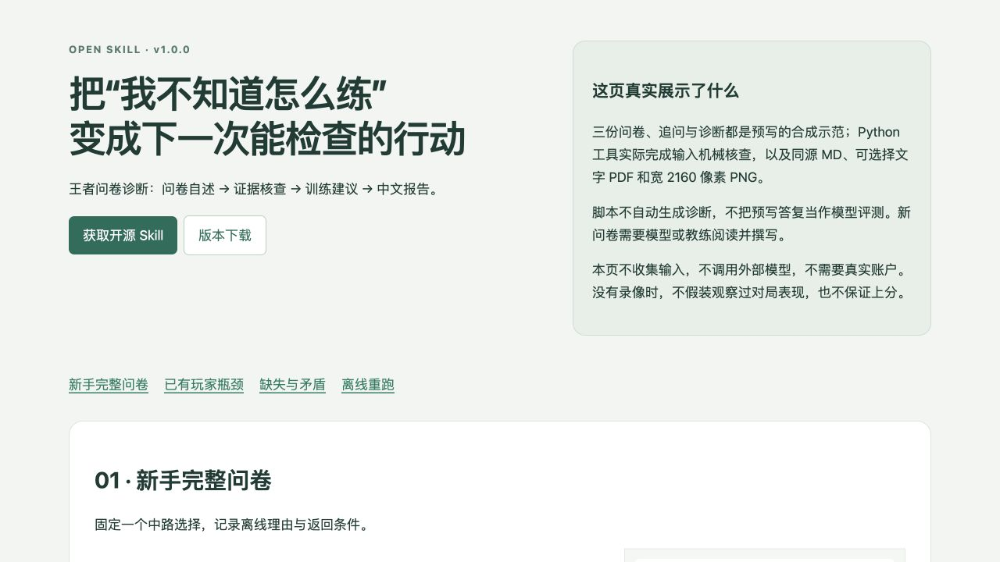

# 王者问卷诊断 · 开源版

把王者荣耀问卷自述变成可核查的训练建议，再交付 **Markdown、可选择文字的中文 PDF、宽 2160 像素 PNG**。适合独立教练、小型教学团队，以及想把“我不知道怎么练”整理成具体问题的玩家。

[在线完整 Demo](https://songliv66.github.io/wangzhe-diagnosis-open/) · [三个合成案例](examples/README.md) · [v1.0.0 下载](https://github.com/songliv66/wangzhe-diagnosis-open/releases/tag/v1.0.0) · [许可与来源](NOTICE.md)



## 它解决什么问题

问卷通常混着已知、自我感觉与尚未解释的矛盾。本 Skill 让模型先划清证据范围，再把问题变成训练假设、观察条件、替代动作与复查办法。只有自述时，报告不会假装看过对局，也不保证段位、胜率、战力或指定时间的结果。

**分工必须说清楚**：模型或教练阅读答卷并写诊断；Python 检查器只做有限的字段/冲突检查；排版器只把已写好的 Markdown 生成三格式。本仓库不是自动打分模型，不含模型 API、支付系统、私信机器人或学生数据库。

## 五分钟快速开始

支持 Python 3.10-3.13，macOS 与 Linux；需要 Poppler 的 `pdftoppm`。本次实际验收平台为 macOS、Python 3.12；Windows 未实测，可通过 WSL 尝试。

```bash
git clone https://github.com/songliv66/wangzhe-diagnosis-open.git
cd wangzhe-diagnosis-open
python3 -m venv .venv
source .venv/bin/activate
python3 -m pip install -r requirements.txt
```

安装 Poppler（按系统选一条）：

```bash
# macOS
brew install poppler
# Ubuntu / Debian
sudo apt-get install poppler-utils
```

**一条命令重跑全部 Demo**（依赖装好后，目录必须尚不存在）：

```bash
python3 scripts/run_demo.py --output-dir outputs/demo-first
```

会检查三份原始合成 JSON，并从三份预写诊断真正生成 `report.md`、`report.pdf`、`report.png`、`manifest.json` 和 `input-review.json`。重复运行请换 `outputs/demo-second` 等新目录；工具拒绝覆盖。它重演排版工作流，不让模型重新回答，不是模型基准。

## 给你自己的问卷做诊断

1. 把本文件夹作为 Skill 安装到支持 SKILL.md 的代理中，例如 `~/.codex/skills/wangzhe-diagnosis-open`（也可软链到下载目录）。只安装公开包，不替换其他个人版 Skill。
2. 用 [纯填空问卷](assets/questionnaire.txt) 收集答案。姓名、战力、录像可缺；若位置、目标和问题都未知，先补能决定建议的关键项。
3. 复制下面的提示词，把问卷直接贴给模型。诊断由模型执行，需要你选择的模型/代理环境；离线排版不需要账号。

```text
使用 $wangzhe-diagnosis-open。请根据以下问卷写训练诊断，
区分自述、推断与未知，核查会改变建议的缺失/矛盾。
未给录像，不要描述已观察到的操作；给下一次练习和复查条件。
请把完整 Markdown、可选择文字 PDF、高清 PNG 输出到一个新目录。
教练配置使用 config/coach.example.json。
【在这里粘贴问卷】
```

模型写好 `my-report.md` 后，可在本仓库根手动导出：

```bash
python3 scripts/render_report.py my-report.md --output-dir outputs/my-report-first --profile config/coach.example.json --order-id demo-order
python3 scripts/check_output.py outputs/my-report-first --source my-report.md
```

## 配置你自己的教练资料

复制 `config/coach.example.json` 到仓库外，设置 `coach_name`、`contact`、可选本地 `avatar`、可选 `output_dir`、`teaching_sources`。命令行输出目录优先。署名、头像、联系可以留空；头像只接受有使用权的 PNG/JPG，不从 URL 下载。公开样例联系仅为 **puddingvoid**，未预设平台。

详细约束、字体替换与依赖排错见 [配置说明](references/configuration.md)。教学材料由教练自己提供且确保有权使用；本包不附任何私人课程、真人答卷或付费资料。具体英雄机制与版本强度须从获授权、已核实的材料确认，不能把一般训练原则包装成当前最优攻略。

## 三个完整案例与实际产物

| 场景 | 输入与核查 | 诊断与产物 |
|---|---|---|
| 新手完整问卷 | [原始问卷](examples/01-beginner/input.json) · [核查示范](examples/01-beginner/clarification.md) | [诊断 MD](examples/01-beginner/output/report.md) · [PDF](examples/01-beginner/output/report.pdf) · [PNG](examples/01-beginner/output/report.png) |
| 已有辅助玩家的游走瓶颈 | [原始问卷](examples/02-bottleneck/input.json) · [核查示范](examples/02-bottleneck/clarification.md) | [诊断 MD](examples/02-bottleneck/output/report.md) · [PDF](examples/02-bottleneck/output/report.pdf) · [PNG](examples/02-bottleneck/output/report.png) |
| 缺失、冲突与未回复 | [原始问卷](examples/03-ambiguous/input.json) · [追问与条件分支](examples/03-ambiguous/clarification.md) | [诊断 MD](examples/03-ambiguous/output/report.md) · [PDF](examples/03-ambiguous/output/report.pdf) · [PNG](examples/03-ambiguous/output/report.png) |

各案例附可复制 `prompt.txt`。所有输入和核查对话完全合成；诊断正文为作者预写模拟答复。PDF/PNG 则由本仓库脚本实际生成，manifest 可核验其指纹。在线页面可展开问卷、提示词、核查和完整诊断，没有输入上传框、不收集学生资料、不暗中调用外部模型。

离线浏览（在仓库根运行，打开 `http://localhost:8000`）：

```bash
python3 -m http.server 8000 --directory docs
```

也可直接打开 `docs/index.html`；页面的报告、文字与下载均使用本地资源。页面预览图可点击查看原图；纯文字版本与 PDF 同时提供。

## 输入、输出与局限

输入可以是自然语言问卷；可选 JSON 机械核查工具见 [输入契约](references/input-contract.md)。输出的 Markdown 是正文真源，PDF 与 PNG 同源生成；[格式约定](references/report-format.md) 说明支持的语法。字体随包分发并按 OFL 单独授权，输出不依赖本机中文字体。

自动检查不能判断问卷真实性、识别所有矛盾、看懂未提供的录像或保证教学正确。PNG 是纵向单页，超长报告会要求拆分；复杂 Markdown、图表、网络图片与自动分页不在 v1.0.0 范围。更换问卷、正文或配置要导出到新目录并重新审核，旧结论不自动适用。

## 验证与维护

```bash
python3 -m unittest discover -s tests -v
python3 scripts/review_input.py examples/01-beginner/input.json examples/02-bottleneck/input.json examples/03-ambiguous/input.json
```

测试覆盖缺失/冲突、非法类型/重复 JSON 键、重复订单、超长字段、问卷指令不执行、重复运行与已有文件保护、缺依赖/字体/渲染器、本地头像约束及真实三格式导出。包含长署名/联系与可选合成头像的实际导出；机械检查不代替图片审校。见 [验收记录](VALIDATION.md)。仓库仅提供可手动启用的 [CI 示例](docs/ci-example.yml)；本机测试通过不代表远端 CI 已运行。

维护采用尽力而为：欢迎用 GitHub Issues 提交可复现的合成输入、报错和改进建议，不要上传学生隐私。没有固定响应时限，也不承诺持续更新每个游戏版本。公开联系 **puddingvoid**（平台未指定）。

## 许可与私有版边界

公开版代码、说明和合成案例为独立重写，按 [MIT](LICENSE) 授权；字体按 SIL OFL 1.1，各运行依赖保留自己的许可。[NOTICE](NOTICE.md) 逐项列出来源与范围。本包不含游戏图片、真人头像、真实答卷、私人分支、旧 Git 历史或内部路径，也没有把原私有包整体改为公开。私有原版与本机安装保留原样。
